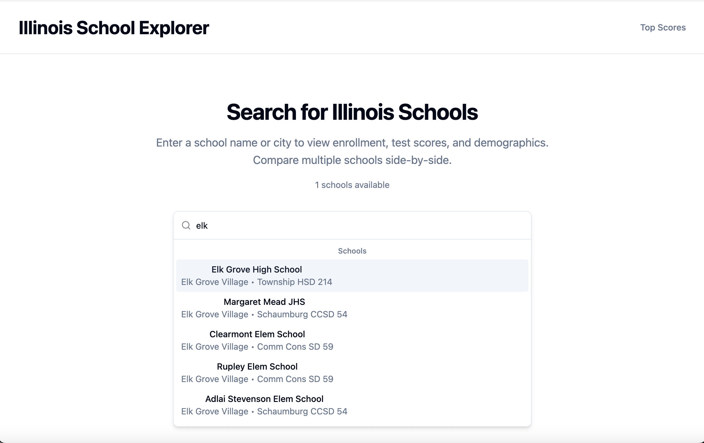
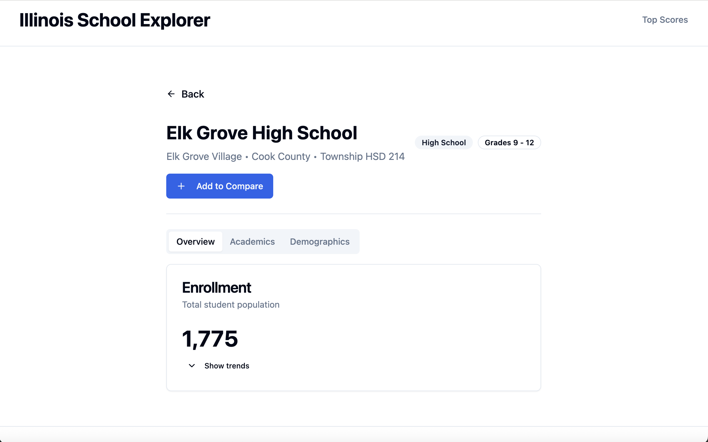
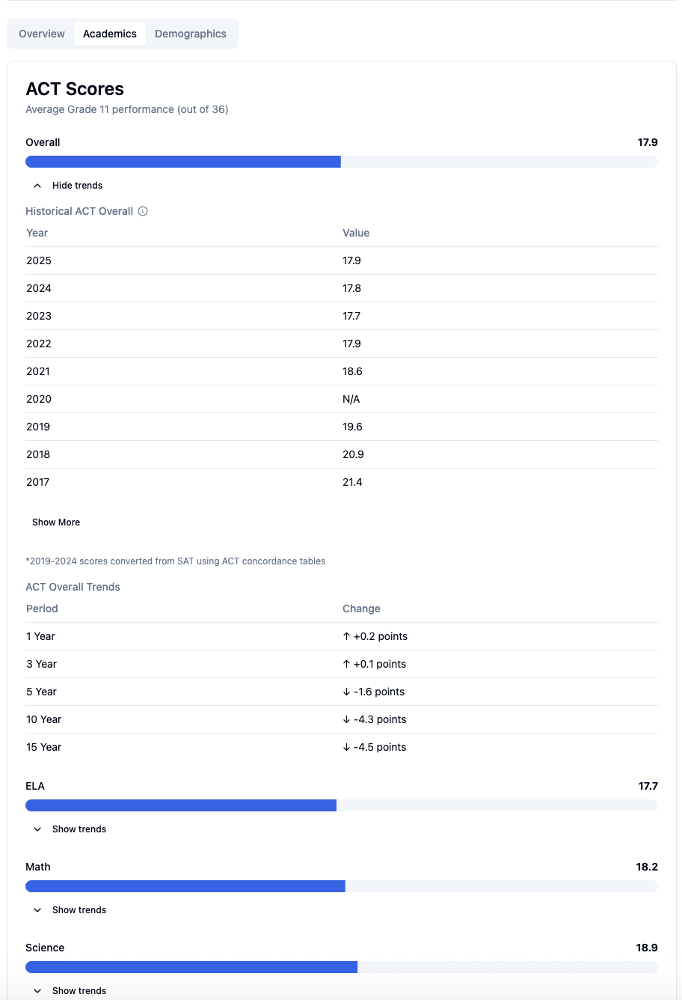
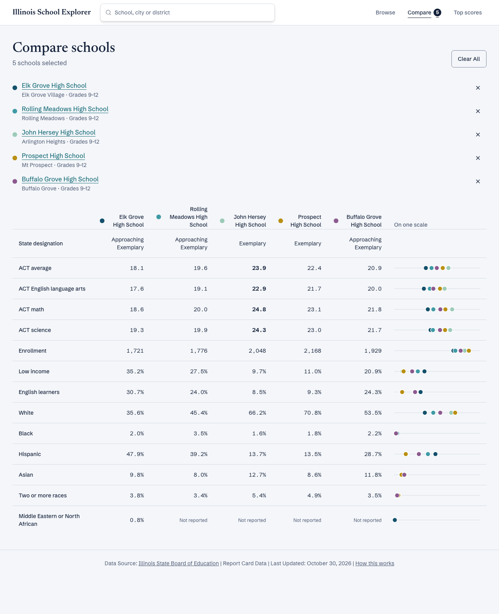
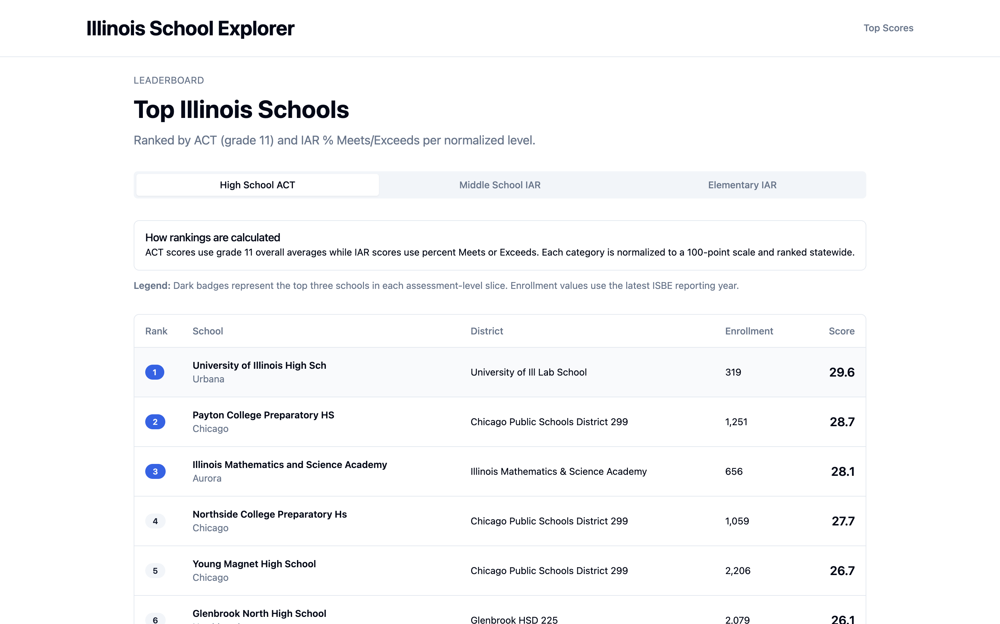

# Illinois School Explorer

A full-stack web application for exploring and comparing Illinois K-12 schools using official 2026 Report Card data (2025-26 school year) from the Illinois State Board of Education.

**Live Application:** https://illinois-school-explorer.vercel.app


*Screenshot: Main search interface with full-text search across 3,828 Illinois schools*

---

## Overview

Finding and comparing Illinois schools shouldn't require navigating spreadsheets with 899 columns. This application transforms the Illinois State Board of Education's 2026 Report Card dataset into an interactive, searchable web experience.

**What it does:**
- **Search** 3,828 Illinois schools by name, city, or district
- **Explore** detailed metrics: enrollment, test scores (ACT/IAR), demographics, diversity
- **Compare** schools side-by-side with persistent comparison basket
- **Analyze** historical trends (1, 3, 5, 10, and 15-year windows) for enrollment, demographics, and test scores
- **Discover** top-performing schools through ranked leaderboards

**Why I built this:**

As someone interested in education data and full-stack development, I wanted to create a practical tool that makes public education data more accessible while demonstrating modern web application architecture. The project showcases end-to-end full-stack development: data processing and normalization, REST API design, responsive UI development, and production deployment.

---

## Live Demo

**Frontend:** https://illinois-school-explorer.vercel.app
**Backend API:** https://illinois-school-explorer-production.up.railway.app
**API Documentation:** https://illinois-school-explorer-production.up.railway.app/docs (Interactive Swagger UI)

---

## Features & Screenshots

### 1. School Search & Discovery

Full-text search powered by SQLite FTS5, ranking results by relevance across school names, cities, and districts.


*Screenshot: Search results with highlighted matches and school metadata*

**Technical highlights:**
- FTS5 (Full-Text Search) with rank-based sorting
- Debounced search input for performance
- Keyboard navigation support
- TanStack Query for intelligent caching

---

### 2. Detailed School Profiles

One scrolling page per school: key facts, the state designation, test scores, history back to 2010, students and enrollment.


*Screenshot: School detail page*

**Sections, in order:**
- **Key facts:** Grades, students, low-income share
- **State designation:** The school's 2026 level on ISBE's five-step scale, with a link to its Illinois Report Card profile
- **Test scores:** ACT average (high schools) or IAR proficiency (elementary/middle schools) with the change from 2025
- **Over time:** ACT line chart from 2010 with the SAT years shaded and missing years left as gaps; IAR shows 2025 against 2026
- **Students:** English learners and low income with sparklines, and one bar for all race and ethnicity groups with data
- **Enrollment:** Current figure, change since the first reported year, sparkline


*Screenshot: Year-by-year history*

**Technical highlights:**
- Recharts line chart with touch scrubbing; sparklines and the composition bar are plain SVG and CSS
- Tapping a sparkline opens the full chart and a year-by-year table in a bottom sheet
- Null-safe rendering for suppressed data (privacy protection)
- Sticky section links; two columns on desktop

---

### 3. Side-by-Side School Comparison

Compare 2-5 schools simultaneously with persistent comparison basket across page navigation.


*Screenshot: Multi-school comparison table with side-by-side metrics*

**Technical highlights:**
- React Context for global comparison state
- LocalStorage persistence
- Multi-select UI with add/remove controls
- Handles missing data gracefully (schools without certain metrics)

---

### 4. Top Scores Leaderboard

Ranked lists of top-performing schools by ACT composite (high schools) or IAR proficiency (elementary/middle schools).


*Screenshot: Top 100 schools ranked by assessment type and filtered by school level*

**Technical highlights:**
- Filter by school level (elementary, middle, high)
- Filter by assessment type (ACT, IAR)
- Proper tie-breaking for equal scores
- Efficient database queries with proper indexing

---

## Tech Stack

### Backend
- **FastAPI** - Modern Python web framework with automatic OpenAPI documentation
- **SQLite with FTS5** - Lightweight database with full-text search capabilities
- **SQLAlchemy 2.0** - ORM with modern async-ready query patterns
- **Pydantic** - Request/response validation and serialization
- **pytest** - Comprehensive test suite with 79 tests and >80% coverage

### Frontend
- **React 19 + TypeScript** - Type-safe component-based UI
- **Vite** - Lightning-fast build tool and dev server
- **TanStack Query v5** - Powerful server state management with caching
- **shadcn/ui + Tailwind CSS** - Accessible component library with utility-first styling
- **React Router v7** - Client-side routing with data loading
- **Vitest + Playwright** - Unit testing and end-to-end test automation

### Deployment & DevOps
- **Railway** - Backend hosting with automatic deploys from GitHub
- **Vercel** - Frontend hosting with edge network distribution
- **GitHub Actions** - Continuous integration (future enhancement)

---

## Architecture

### System Design

```
┌─────────────────┐         HTTP/JSON          ┌──────────────────┐
│   React Client  │ ◄────────────────────────► │  FastAPI Backend │
│   (Vercel)      │                             │   (Railway)      │
└─────────────────┘                             └──────────────────┘
        │                                                │
        │ TanStack Query                                │ SQLAlchemy ORM
        │ (caching, state)                              │
        │                                                ▼
        │                                        ┌──────────────────┐
        │                                        │  SQLite Database │
        │                                        │   + FTS5 Index   │
        │                                        │   (3,828 schools)│
        │                                        └──────────────────┘
        │
        ▼
   localStorage
   (comparison basket)
```

### Backend Architecture

**REST API Design:**
- 4 primary endpoints with clear, RESTful resource naming
- Pydantic models ensure type safety from database to JSON response
- CORS configured for both development and production origins
- Automatic OpenAPI (Swagger) documentation generation

**Database Schema:**
- Denormalized design for read performance (353 columns)
- FTS5 virtual table for fast full-text search
- 60 trend columns (12 metrics × 1/3/5/10/15-year windows)
- 255 historical columns (17 years × 15 metrics)

**Data Processing Pipeline:**
1. Fetch current-year data (General, ACT, IAR tables) from ReportCardAPI
2. Fetch 16 years of history, probing each year's schema to handle format changes
3. Normalize data (suppressed values, school levels, SAT-to-ACT conversion)
4. Calculate trends from historical Report Card data (2010-2026)
5. Bulk insert with SQLAlchemy for efficiency

### Frontend Architecture

**Component Patterns:**
- Presentational/Container separation
- Custom hooks for API integration (`useSchoolDetail`, `useSearch`)
- Composed components for complex UI (HistorySparkline = Sparkline + HistorySheet + HistoryChart)
- Type-safe props with TypeScript interfaces

**State Management:**
- TanStack Query for server state (automatic caching, background refetching)
- React Context for global client state (comparison basket)
- URL search params for shareable filter state
- LocalStorage for persistence across sessions

**Performance Optimizations:**
- Query result caching (5-minute stale time)
- Debounced search input
- Lazy loading for heavy components
- Optimized bundle splitting with Vite

---

## Data Pipeline

### Source Data

**Source:** Illinois State Board of Education Report Card public data sets (2010-2026), served by [ReportCardAPI](https://reportcard-api-production.up.railway.app), a companion REST API that stores each year in its own table.

- **Current year:** 2026 Report Card (2025-26 school year), 3,828 schools
- **History:** 2010-2025 enrollment, demographics, diversity, and ACT/SAT scores
- **Score normalization:** SAT years (2019, 2021-2024) converted to ACT with the official concordance table

### Sync Process

```bash
cd backend
export REPORT_CARD_API_KEY=<key>
uv run python -m app.utils.sync_from_api
```

**Processing steps:**
1. Fetch and merge current-year General, ACT, and IAR tables
2. Filter to school-level entities (exclude districts, state aggregates)
3. Probe each historical year's schema and fetch the matching columns
4. Normalize school types to standard levels (elementary, middle, high, other)
5. Calculate 1/3/5/10/15-year trends from 17 years of data
6. Bulk insert 3,828 records with 300+ fields each

**Output:** SQLite database (10MB) committed to the repo and optimized for read-heavy operations

---

## Project Structure

```
illinois-school-explorer/
├── backend/                       # FastAPI REST API
│   ├── app/
│   │   ├── api/                   # Route handlers (schools, search, compare, top-scores)
│   │   │   ├── schools.py         # School detail & comparison endpoints
│   │   │   ├── search.py          # Full-text search endpoint
│   │   │   └── top_scores.py      # Leaderboard endpoint
│   │   ├── services/              # Business logic layer
│   │   │   └── top_scores.py      # Ranking and filtering logic
│   │   ├── utils/                 # Data sync utilities
│   │   │   ├── sync_from_api.py   # ReportCardAPI → SQLite sync and trend calculation
│   │   │   └── api_client.py      # ReportCardAPI HTTP client
│   │   ├── database.py            # SQLAlchemy ORM models (School, FTS5)
│   │   ├── models.py              # Pydantic response schemas
│   │   └── main.py                # FastAPI application setup
│   ├── docs/
│   │   ├── API_ENDPOINTS.md       # Complete API reference with examples
│   │   └── DATABASE_SCHEMA.md     # Detailed schema documentation
│   ├── data/schools.db            # SQLite database (committed, deployed with the API)
│   ├── tests/                     # 11 test files (119 tests, 98% coverage)
│   │   ├── test_schools_api.py    # API endpoint tests
│   │   ├── test_sync_from_api.py  # Data sync tests
│   │   └── ...
│   └── CLAUDE.md                  # Backend setup & development guide
│
├── frontend/                      # React + TypeScript UI
│   ├── src/
│   │   ├── components/            # Reusable React components
│   │   │   ├── SchoolDetailView.tsx     # School profile display
│   │   │   ├── SiteHeader.tsx           # Site title, desktop search and navigation
│   │   │   ├── BottomTabBar.tsx         # Phone navigation with Compare count
│   │   │   ├── HistoryChart.tsx         # Line chart of a metric since 2010
│   │   │   ├── HistorySheet.tsx         # Bottom sheet: chart and year-by-year table
│   │   │   ├── Sparkline.tsx            # Small inline trend line
│   │   │   ├── CompositionBar.tsx       # Stacked bar for race and ethnicity
│   │   │   ├── DesignationScale.tsx     # State designation on the five-step scale
│   │   │   ├── SchoolComparisonCard.tsx # Individual comparison card
│   │   │   └── ui/                      # shadcn/ui components
│   │   ├── routes/                # Page components
│   │   │   ├── Home.tsx           # Landing page with search
│   │   │   ├── SchoolDetail.tsx   # School profile page
│   │   │   ├── Compare.tsx        # Side-by-side comparison
│   │   │   └── TopScores.tsx      # Leaderboard page
│   │   ├── lib/
│   │   │   ├── api/               # API integration layer
│   │   │   │   ├── client.ts      # Axios instance with base config
│   │   │   │   ├── types.ts       # TypeScript types matching backend
│   │   │   │   └── queries.ts     # TanStack Query hooks
│   │   │   ├── history.ts         # Year series, gaps and change wording
│   │   │   └── trendUtils.ts      # Trend formatting utilities
│   │   └── App.tsx                # Root component with routing
│   ├── tests/
│   │   ├── e2e/                   # Playwright end-to-end tests
│   │   └── [component].test.tsx  # 33 Vitest unit test files
│   └── CLAUDE.md                  # Frontend setup & component docs
│
├── docs/
│   ├── plans/                     # Implementation plans
│   └── screenshots/               # App screenshots
│
├── CLAUDE.md                      # Development guidelines and conventions
└── README.md                      # This file
```

---

## Quick Start

### Prerequisites
- **Python 3.11+** with `uv` package manager
- **Node.js 18+** with `npm`
- **Git** for version control

### Backend Setup

```bash
# 1. Navigate to backend directory
cd backend

# 2. Install dependencies with uv
uv sync --all-extras

# 3. Start the FastAPI development server (data/schools.db is committed and ready to use)
uv run uvicorn app.main:app --reload --port 8000
```

**Backend running at:** http://localhost:8000
**API Documentation:** http://localhost:8000/docs

### Frontend Setup

```bash
# 1. Navigate to frontend directory (from project root)
cd frontend

# 2. Install dependencies
npm install

# 3. Copy environment template
cp .env.example .env.local

# 4. Start the Vite development server
npm run dev
```

**Frontend running at:** http://localhost:5173

---

## Testing

### Backend Tests (pytest)

```bash
cd backend

# Run all tests (including slow integration tests)
uv run pytest

# Run only fast unit tests
uv run pytest -m "not slow"

# Run with coverage report
uv run pytest --cov=app --cov-report=term-missing

# Run specific test file
uv run pytest tests/test_schools_api.py -v
```

**Test Coverage:**
- 13 test files, 79 total tests
- >80% overall coverage
- >95% coverage on API modules

### Frontend Tests (Vitest + Playwright)

```bash
cd frontend

# Run unit tests
npm run test:run

# Run unit tests in watch mode
npm run test

# Run end-to-end tests (start the backend on port 8000 first)
npm run test:e2e -- --reporter=list

# Run E2E tests in UI mode
npm run test:e2e:ui
```

**Test Coverage:**
- 33 unit test files (199 tests)
- 9 E2E test files, each run at desktop and phone width, covering critical user flows, the school page for each kind of school, the theme in light and dark mode, and tap target sizes
- Tests for components, API integration, routing, and full user journeys

---

## API Endpoints

**Development:** http://localhost:8000
**Production:** https://illinois-school-explorer-production.up.railway.app
**Interactive Docs:** http://localhost:8000/docs (Swagger UI)

### Endpoints Overview

| Endpoint | Method | Description |
|----------|--------|-------------|
| `/api/search` | GET | Full-text search across school names, cities, and districts |
| `/api/schools/{rcdts}` | GET | Retrieve complete school details by RCDTS identifier |
| `/api/schools/compare` | GET | Compare 2-5 schools side-by-side |
| `/api/top-scores` | GET | Ranked leaderboard by ACT or IAR scores |
| `/api/stats` | GET | School, district and city counts |
| `/health` | GET | Health check endpoint |

### Example API Calls

**Search for schools:**
```bash
curl "http://localhost:8000/api/search?q=Elk+Grove&limit=10"
```

**Get school details:**
```bash
curl "http://localhost:8000/api/schools/05-016-2140-17-0002"
```

**Compare multiple schools:**
```bash
curl "http://localhost:8000/api/schools/compare?rcdts=05-016-2140-17-0002,05-016-2220-17-0001"
```

**Top 50 high schools by ACT:**
```bash
curl "http://localhost:8000/api/top-scores?assessment=act&level=high&limit=50"
```

See [backend/docs/API_ENDPOINTS.md](backend/docs/API_ENDPOINTS.md) for complete API documentation with request/response examples.

---

## Production Deployment

### Frontend (Vercel)

**URL:** https://illinois-school-explorer.vercel.app

**Configuration:**
- **Platform:** Vercel
- **Framework:** Vite (auto-detected)
- **Root Directory:** `frontend`
- **Build Command:** `npm run build`
- **Output Directory:** `dist`
- **Auto-deploy:** Enabled from `main` branch

**Environment Variables:**
```
VITE_API_URL=https://illinois-school-explorer-production.up.railway.app
```

### Backend (Railway)

**URL:** https://illinois-school-explorer-production.up.railway.app

**Configuration:**
- **Platform:** Railway
- **Framework:** Python via Nixpacks, configured by `backend/nixpacks.toml` and `backend/railway.toml`
- **Root Directory:** `backend`
- **Start Command:** `.venv/bin/uvicorn app.main:app --host 0.0.0.0 --port $PORT`
- **Auto-deploy:** Enabled from `main` branch

**Environment Variables:**
```
ALLOWED_ORIGINS=http://localhost:5173,http://127.0.0.1:5173,https://illinois-school-explorer.vercel.app
```

**Database:**
- SQLite file (10MB) committed to git at `backend/data/schools.db` and deployed with the code
- Read-only in production; no Railway volume
- No external database service required

### Deployment Workflow

1. **Develop locally** with hot-reload dev servers
2. **Run tests** to ensure changes don't break functionality
3. **Commit and push** to `main` branch on GitHub
4. **Automatic deployment:**
   - Railway rebuilds backend (2-3 minutes)
   - Vercel rebuilds frontend (1-2 minutes)
5. **Verify** at production URLs


---

## Key Concepts

### RCDTS Identifiers

Every Illinois school has a unique **RCDTS code** (Regional County District Type School):
- **Format:** `05-016-2140-17-0002` (hyphen-separated)
- **Usage:** Primary identifier for school lookups, comparisons, and detail pages
- **Stability:** Codes remain constant across years

### School Levels

Schools are categorized into normalized levels for filtering and leaderboards:
- `elementary` - Elementary and primary schools
- `middle` - Middle and junior high schools
- `high` - High schools
- `other` - Alternative and special education schools

Computed during data sync from the original `school_type` field.

### Suppressed Data

Illinois suppresses certain metrics when student counts are too low (< 10 students) for privacy protection:
- **In source data:** Markers such as `*n<10` in ISBE data sets (`null` from ReportCardAPI)
- **In database:** `NULL` values
- **In API responses:** `null` in JSON
- **In frontend:** Displayed as "N/A"

Common scenarios:
- ACT scores for elementary schools (no ACT testing)
- Small demographic categories
- New schools without historical data

### Historical Trends

Multi-year changes (current value minus base-year value) calculated from historical Report Card data:
- **1-year trend:** 2025 → 2026
- **3-year trend:** 2023 → 2026
- **5-year trend:** 2021 → 2026
- **10-year trend:** 2016 → 2026
- **15-year trend:** 2011 → 2026

Trends are pre-calculated during data sync and stored as database columns for instant querying.

---

## Future Enhancements

### Feature Additions
- [ ] Advanced filtering (by enrollment range, test score range, demographics)
- [ ] Geographic search with map view (Mapbox/Google Maps)
- [ ] Export comparisons to PDF or CSV

### Technical Improvements
- [ ] PostgreSQL migration for better scalability
- [ ] GraphQL API alongside REST
- [ ] Redis caching layer
- [ ] API authentication and rate limiting
- [ ] Performance monitoring (Sentry, DataDog)
- [ ] CI/CD pipeline with GitHub Actions

---

## Documentation

- **[Backend](backend/CLAUDE.md)** - Complete backend setup and API documentation
- **[Frontend](frontend/CLAUDE.md)** - Frontend architecture and component guide
- **[Database Schema](backend/docs/DATABASE_SCHEMA.md)** - Detailed database structure
- **[API Endpoints](backend/docs/API_ENDPOINTS.md)** - API reference with examples

---

## License

MIT License - feel free to use this project as a reference or starting point for your own work.

---

## Contact

**Kyle Pfister**

- **GitHub:** [@kpfister44](https://github.com/kpfister44)
- **LinkedIn:** https://www.linkedin.com/in/kyle-pfister-510753286/
- **Email:** kpfister44@gmail.com

**Have questions or suggestions?** Open an issue on GitHub or reach out directly!

---

**Built using FastAPI, React, and public education data from the Illinois State Board of Education.**
